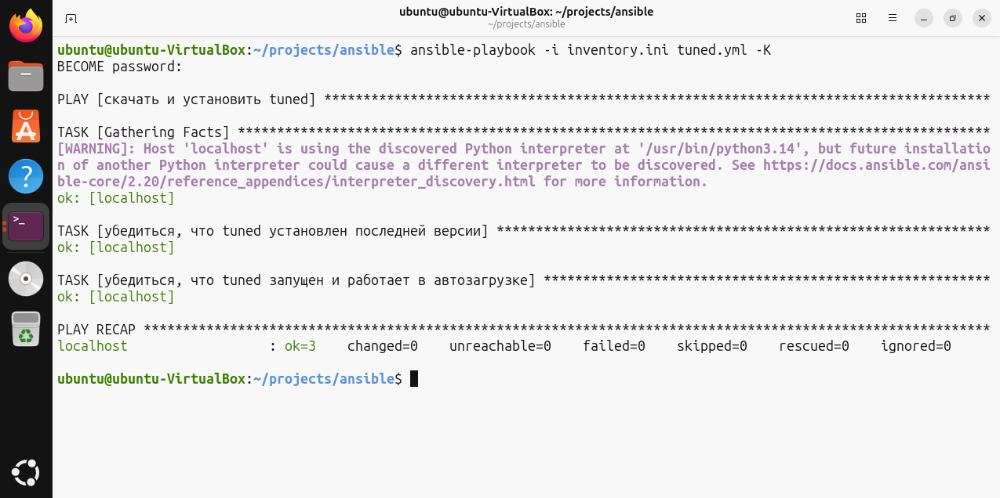
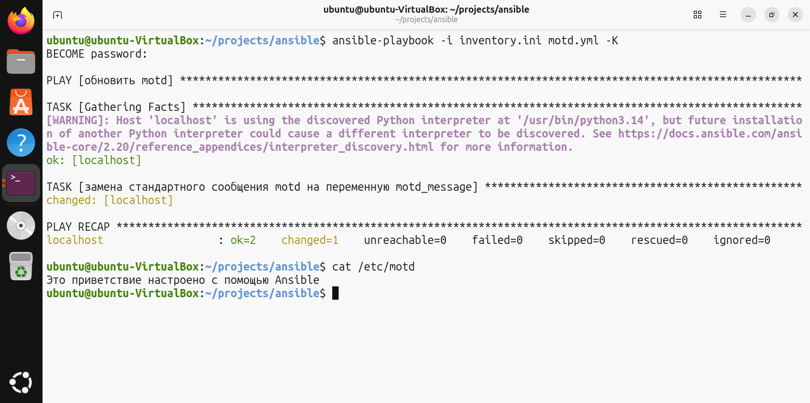
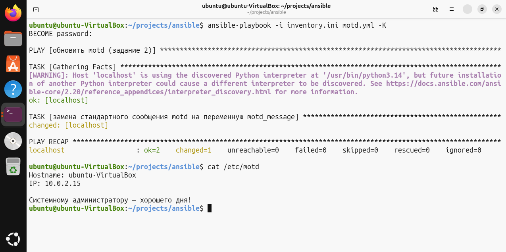
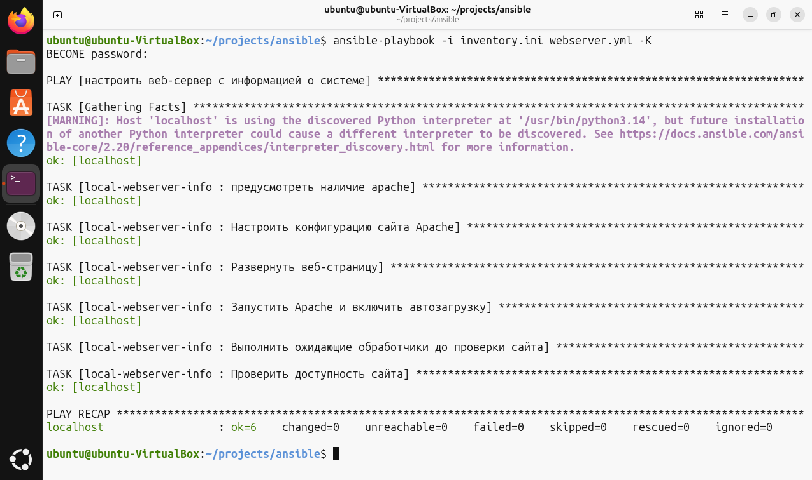
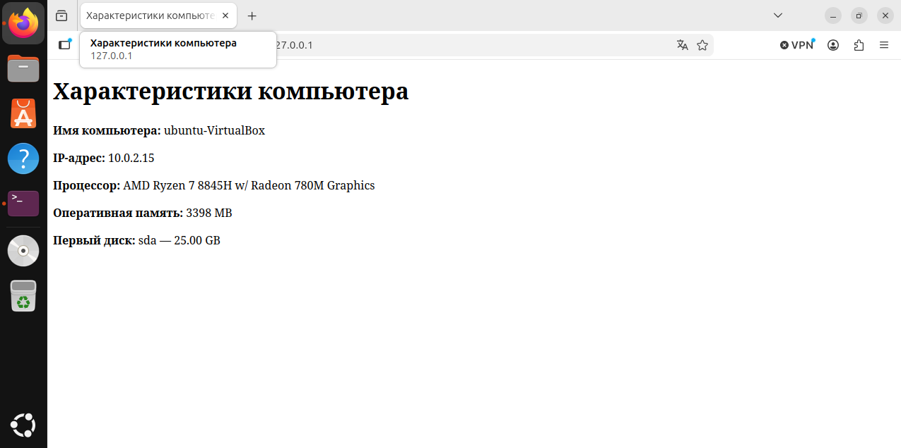

# Домашнее задание к занятию "`Ansible. Часть 2`" - `Шиянов Никита`


### Инструкция по выполнению домашнего задания

   1. Сделайте `fork` данного репозитория к себе в Github и переименуйте его по названию или номеру занятия, например, https://github.com/имя-вашего-репозитория/git-hw или  https://github.com/имя-вашего-репозитория/7-1-ansible-hw.
   2. Выполните клонирование данного репозитория к себе на ПК с помощью команды `git clone`.
   3. Выполните домашнее задание и заполните у себя локально этот файл README.md:
      - впишите вверху название занятия и вашу фамилию и имя
      - в каждом задании добавьте решение в требуемом виде (текст/код/скриншоты/ссылка)
      - для корректного добавления скриншотов воспользуйтесь [инструкцией "Как вставить скриншот в шаблон с решением](https://github.com/netology-code/sys-pattern-homework/blob/main/screen-instruction.md)
      - при оформлении используйте возможности языка разметки md (коротко об этом можно посмотреть в [инструкции  по MarkDown](https://github.com/netology-code/sys-pattern-homework/blob/main/md-instruction.md))
   4. После завершения работы над домашним заданием сделайте коммит (`git commit -m "comment"`) и отправьте его на Github (`git push origin`);
   5. В личном кабинете прикрепите и отправьте ссылку на решение в виде md-файла в вашем Github.
   6. Любые вопросы по выполнению заданий спрашивайте в разделе “Вопросы по заданию” в личном кабинете.
   
Желаем успехов в выполнении домашнего задания!
   
### Дополнительные материалы, которые могут быть полезны для выполнения задания

1. [Руководство по оформлению Markdown файлов](https://gist.github.com/Jekins/2bf2d0638163f1294637#Code)

---

### Задание 1

Напишите три плейбука. При написании рекомендуем использовать текстовый редактор с подсветкой синтаксиса YAML.
Плейбуки должны:

1. Скачать какой-либо архив, создать папку для распаковки и распаковать скаченный архив. Например, можете использовать официальный сайт и зеркало Apache Kafka. При этом можно скачать как исходный код, так и бинарные файлы, запакованные в архив — в нашем задании не принципиально.
2. Установить пакет tuned из стандартного репозитория вашей ОС. Запустить его, как демон — конфигурационный файл systemd появится автоматически при установке. Добавить tuned в автозагрузку.
3. Изменить приветствие системы (motd) при входе на любое другое. Пожалуйста, в этом задании используйте переменную для задания приветствия. Переменную можно задавать любым удобным способом.


#### Решение задания 1.1:

1. Установил Ansible на виртуальную машину

```bash
sudo apt install ansible -y
```

2. Создал рабочую директорию для проекта Ansible и файл ansible inverntory "inventory.ini"

```ini
[myhosts]
localhost ansible_connection=local
```

3. Создал файл ansible playbook `download_archive.yml`; синтаксис для нужных модулей нашел [тут](https://docs.ansible.com/projects/ansible/latest/collections/ansible/builtin/index.html)

```yml
- name: скачать kafka
  hosts: myhosts
  tasks:
   - name: скачать kafka 
     ansible.builtin.get_url:
        url: https://www.apache.org/dyn/closer.lua/kafka/4.4.0/kafka-4.4.0-src.tgz?action=download
        dest: /home/ubuntu/projects/ansible/kafka-4.4.0-src.tgz

   - name: создать директорию для распаковки
     ansible.builtin.file:
        path: /home/ubuntu/projects/ansible/kafka-extracted
        state: directory
        mode: '0755'

   - name: Разархивировать пакет kafka
     ansible.builtin.unarchive:
        src: /home/ubuntu/projects/ansible/kafka-4.4.0-src.tgz
        dest: /home/ubuntu/projects/ansible/kafka-extracted
        remote_src: true
```


#### Решение задания 1.2:

1. Создал файл ansible playbook `tuned.yml`

``` yml
- name: скачать и установить tuned
  hosts: myhosts
  become: true
  tasks:

   - name: убедиться, что tuned установлен последней версии
     ansible.builtin.apt:
        name: tuned
        state: latest

   - name: убедиться, что tuned запущен и работает в автозагрузке
     ansible.builtin.systemd_service:
        name: tuned
        state: started
        enabled: true
```

2. При попытке запуска данного playbook-а командой `ansible-playbook -i inventory.ini tuned.yml -K` появляется ошибка:

``` bash
[ERROR]: Task failed: Timed out waiting for become success or become password prompt.
>>> Standard Error
[sudo: [sudo via ansible, key=kggvxbaxpznxwxxeivaqtepdwrqlvjee] password:] Password:

fatal: [localhost]: UNREACHABLE! => {"changed": false, "msg": "Task failed: Timed out waiting for become success or become password prompt.\n>>> Standard Error\n[sudo: [sudo via ansible, key=kggvxbaxpznxwxxeivaqtepdwrqlvjee] password:] Password:", "unreachable": true}

PLAY RECAP ************************************************************************************************************
localhost                  : ok=0    changed=0    unreachable=1    failed=0    skipped=0    rescued=0    ignored=0   
```

3. Переключил стандартный `sudo` на `/usr/bin/sudo.ws` командой `sudo update-alternatives --set sudo /usr/bin/sudo.ws`

4. Повторный запуск playbook-а `tuned.yml` прошел успешно



#### Решение задания 1.3:

1. Создал файл ansible playbook `motd.yml`

``` yml
- name: обновить motd
  hosts: myhosts
  become: true

  vars:
     motd_message: "Это приветствие настроено с помощью Ansible\n"

  tasks:
   - name: замена стандартного сообщения motd на переменную motd_message
     ansible.builtin.copy:
        content: "{{ motd_message }}"
        dest: /etc/motd
```
2. Запустил playbook командой `ansible-playbook -i inventory.ini motd.yml -K`; стандартное сообщение motd успешно заменено на значение переменной `motd_message`



---

### Задание 2

Выполните действия, приложите файлы с модифицированным плейбуком и вывод выполнения.

Модифицируйте плейбук из пункта 3, задания 1. В качестве приветствия он должен установить IP-адрес и hostname управляемого хоста, пожелание хорошего дня системному администратору.

#### Решение 2-го задания:

1. Модифицировал ansible playbook `motd.yml` так, чтобы была использована подстановка фактов в переменную `motd_message`

``` yml
- name: обновить motd (задание 2)
  hosts: myhosts
  become: true

  vars:
     motd_message: "Hostname: {{ ansible_facts.hostname }}\nIP: {{ ansible_facts.default_ipv4.address }}\n\nСистемному администратору — хорошего дня!\n"

  tasks:
   - name: замена стандартного сообщения motd на переменную motd_message
     ansible.builtin.copy:
        content: "{{ motd_message }}"
        dest: /etc/motd
```

2. Вывод команды запуска playbook-а и печать сообщения сформированного `/etc/motd`



---

### Задание 3

Выполните действия, приложите архив с ролью и вывод выполнения.

Ознакомьтесь со статьёй «Ansible - это вам не bash», сделайте соответствующие выводы и не используйте модули shell или command при выполнении задания.
Создайте плейбук, который будет включать в себя одну, созданную вами роль. Роль должна:

1. Установить веб-сервер Apache на управляемые хосты.
2. Сконфигурировать файл index.html c выводом характеристик каждого компьютера как веб-страницу по умолчанию для Apache. Необходимо включить CPU, RAM, величину первого HDD, IP-адрес. Используйте Ansible facts и jinja2-template. Необходимо реализовать handler: перезапуск Apache только в случае изменения файла конфигурации Apache.
3. Открыть порт 80, если необходимо, запустить сервер и добавить его в автозагрузку.
4. Сделать проверку доступности веб-сайта (ответ 200, модуль uri).

#### Решение 3-го задания:

1. Создал новый ansible playbook файл `webserver.yml` и структуру для роли для задания:

```
ansible/
 ├── ...
 ├── webserver.yml
 └── roles/
	 └── local-webserver-info
	    ├── tasks/
	    │   └── main.yml
	    ├── handlers/
	    │   └── main.yml
	    └── templates/
	        ├── local-webserver-info.conf.j2
	        └── index.html.j2
```
2. Создал файл `webserver.yml`:

```yml
- name: настроить веб-сервер с информацией о системе
  hosts: myhosts
  become: true
  roles:
   - local-webserver-info
```

3. Создал файл `tasks/main.yml`:

```yml
- name: предусмотреть наличие apache
  ansible.builtin.apt:
    name: apache2
    state: present

- name: Настроить конфигурацию сайта Apache
  ansible.builtin.template:
    src: local-webserver-info.conf.j2
    dest: /etc/apache2/sites-available/000-default.conf
    owner: root
    group: root
    mode: '0644'
  notify: Перезапустить Apache

- name: Развернуть веб-страницу
  ansible.builtin.template:
    src: index.html.j2
    dest: /var/www/html/index.html
    owner: root
    group: root
    mode: '0644'

- name: Запустить Apache и включить автозагрузку
  ansible.builtin.systemd_service:
    name: apache2
    state: started
    enabled: true

- name: Выполнить ожидающие обработчики до проверки сайта
  ansible.builtin.meta: flush_handlers

- name: Проверить доступность сайта
  ansible.builtin.uri:
    url: http://127.0.0.1/
    method: GET
    status_code: 200
    return_content: true
  register: website_response
```

4. Создал файл `handlers/main.yml`:

``` yml
- name: Перезапустить Apache
  ansible.builtin.systemd_service:
    name: apache2
    state: restarted
```

5. Создал файл `local-webserver-info.conf.j2`:

```apacheconf
 <VirtualHost 127.0.0.1:80>
    ServerName localhost
    DocumentRoot /var/www/html
</VirtualHost>
```

6. Создал файл `index.html.j2`:

``` html
 <!DOCTYPE html>
<html lang="ru">
<head>
    <meta charset="UTF-8">
    <title>Характеристики компьютера</title>
</head>
<body>
    <h1>Характеристики компьютера</h1>

    <p><strong>Имя компьютера:</strong> {{ ansible_facts.hostname }}</p>

    <p><strong>IP-адрес:</strong>
        {{ ansible_facts.default_ipv4.address | default('не определён') }}
    </p>

    <p><strong>Процессор:</strong>
        {{ ansible_facts.processor[2] | default('не определён') }}
    </p>

    <p><strong>Оперативная память:</strong>
        {{ ansible_facts.memtotal_mb }} MB
    </p>

    

    
        <p><strong>Первый диск:</strong>
            {{ disks[0].key }} — {{ disks[0].value.size }}
        </p>
    
        <p>Информация о дисках не найдена.</p>
    
</body>
</html>
```

7. Запустил роль командой `ansible-playbook -i inventory.ini webserver.yml -K`. Скриншоты, подтверждающие успешный запуск и корректную работу:


