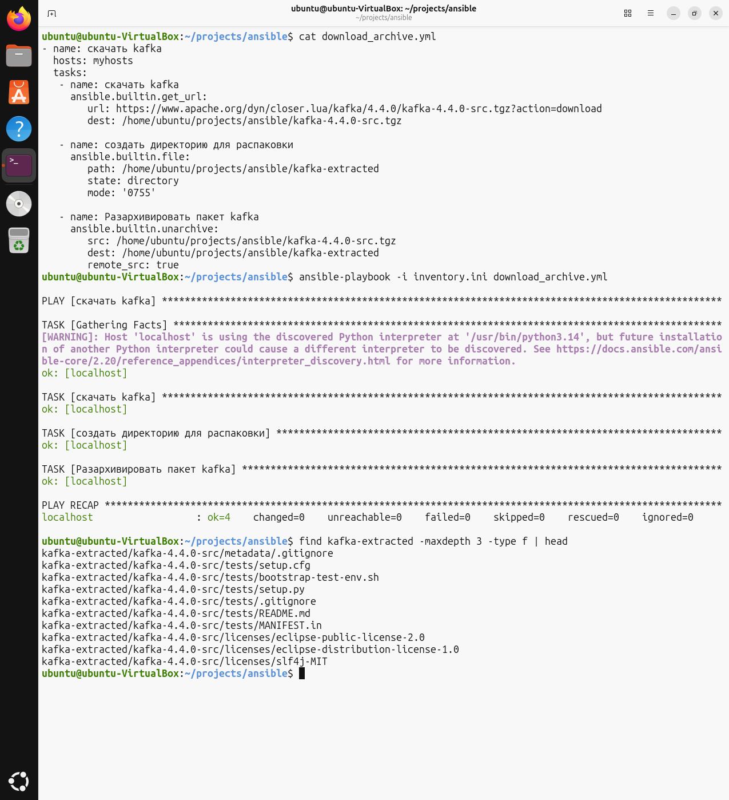

# Домашнее задание к занятию "`Ansible. Часть 2`" - `Шиянов Никита`


### Инструкция по выполнению домашнего задания

   1. Сделайте `fork` данного репозитория к себе в Github и переименуйте его по названию или номеру занятия, например, https://github.com/имя-вашего-репозитория/git-hw или  https://github.com/имя-вашего-репозитория/7-1-ansible-hw.
   2. Выполните клонирование данного репозитория к себе на ПК с помощью команды `git clone`.
   3. Выполните домашнее задание и заполните у себя локально этот файл README.md:
      - впишите вверху название занятия и вашу фамилию и имя
      - в каждом задании добавьте решение в требуемом виде (текст/код/скриншоты/ссылка)
      - для корректного добавления скриншотов воспользуйтесь [инструкцией "Как вставить скриншот в шаблон с решением](https://github.com/netology-code/sys-pattern-homework/blob/main/screen-instruction.md)
      - при оформлении используйте возможности языка разметки md (коротко об этом можно посмотреть в [инструкции  по MarkDown](https://github.com/netology-code/sys-pattern-homework/blob/main/md-instruction.md))
   4. После завершения работы над домашним заданием сделайте коммит (`git commit -m "comment"`) и отправьте его на Github (`git push origin`);
   5. В личном кабинете прикрепите и отправьте ссылку на решение в виде md-файла в вашем Github.
   6. Любые вопросы по выполнению заданий спрашивайте в разделе “Вопросы по заданию” в личном кабинете.
   
Желаем успехов в выполнении домашнего задания!
   
### Дополнительные материалы, которые могут быть полезны для выполнения задания

1. [Руководство по оформлению Markdown файлов](https://gist.github.com/Jekins/2bf2d0638163f1294637#Code)

---

### Задание 1

Напишите три плейбука. При написании рекомендуем использовать текстовый редактор с подсветкой синтаксиса YAML.
Плейбуки должны:

1. Скачать какой-либо архив, создать папку для распаковки и распаковать скаченный архив. Например, можете использовать официальный сайт и зеркало Apache Kafka. При этом можно скачать как исходный код, так и бинарные файлы, запакованные в архив — в нашем задании не принципиально.
2. Установить пакет tuned из стандартного репозитория вашей ОС. Запустить его, как демон — конфигурационный файл systemd появится автоматически при установке. Добавить tuned в автозагрузку.
3. Изменить приветствие системы (motd) при входе на любое другое. Пожалуйста, в этом задании используйте переменную для задания приветствия. Переменную можно задавать любым удобным способом.


#### Решение задания 1.1:

1. Установил Ansible на виртуальную машину

```bash
sudo apt install ansible -y
```

2. Создал рабочую директорию для проекта Ansible и файл "inventory.ini"

```ini
[myhosts]
localhost ansible_connection=local
```

3. Создал файл плейбук-а "download_archive.yml"; синтаксис для нужных модулей нашел [тут](https://docs.ansible.com/projects/ansible/latest/collections/ansible/builtin/index.html)

```yml
- name: скачать kafka
  hosts: myhosts
  tasks:
   - name: скачать kafka 
     ansible.builtin.get_url:
        url: https://www.apache.org/dyn/closer.lua/kafka/4.4.0/kafka-4.4.0-src.tgz?action=download
        dest: /home/ubuntu/projects/ansible/kafka-4.4.0-src.tgz

   - name: создать директорию для распаковки
     ansible.builtin.file:
        path: /home/ubuntu/projects/ansible/kafka-extracted
        state: directory
        mode: '1777'

   - name: Разархивировать пакет kafka
     ansible.builtin.unarchive:
        src: /home/ubuntu/projects/ansible/kafka-4.4.0-src.tgz
        dest: /home/ubuntu/projects/ansible/kafka-extracted
        remote_src: true
```

`

#### Решение задания 1.2:

#### Решение задания 1.3:

---

### Задание 2

Выполните действия, приложите файлы с модифицированным плейбуком и вывод выполнения.

Модифицируйте плейбук из пункта 3, задания 1. В качестве приветствия он должен установить IP-адрес и hostname управляемого хоста, пожелание хорошего дня системному администратору.

#### Решение 2-го задания:

`Приведите ответ в свободной форме........`

1. `Заполните здесь этапы выполнения, если требуется ....`
2. `Заполните здесь этапы выполнения, если требуется ....`


```
Поле для вставки кода...

```

`
---

### Задание 3

Выполните действия, приложите архив с ролью и вывод выполнения.

Ознакомьтесь со статьёй «Ansible - это вам не bash», сделайте соответствующие выводы и не используйте модули shell или command при выполнении задания.
Создайте плейбук, который будет включать в себя одну, созданную вами роль. Роль должна:

1. Установить веб-сервер Apache на управляемые хосты.
2. Сконфигурировать файл index.html c выводом характеристик каждого компьютера как веб-страницу по умолчанию для Apache. Необходимо включить CPU, RAM, величину первого HDD, IP-адрес. Используйте Ansible facts и jinja2-template. Необходимо реализовать handler: перезапуск Apache только в случае изменения файла конфигурации Apache.
3. Открыть порт 80, если необходимо, запустить сервер и добавить его в автозагрузку.
4. Сделать проверку доступности веб-сайта (ответ 200, модуль uri).

#### Решение 3-го задания:

`Приведите ответ в свободной форме........`

1. `Заполните здесь этапы выполнения, если требуется ....`
2. `Заполните здесь этапы выполнения, если требуется ....`


```
Поле для вставки кода...

```

`
