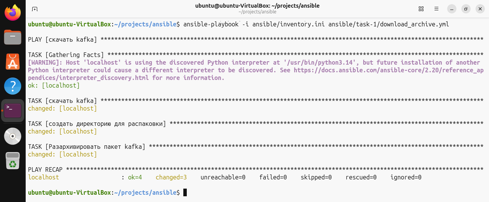
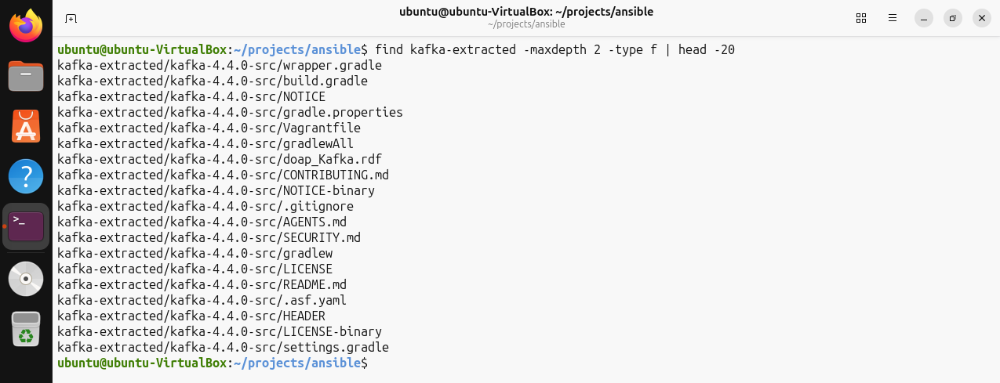
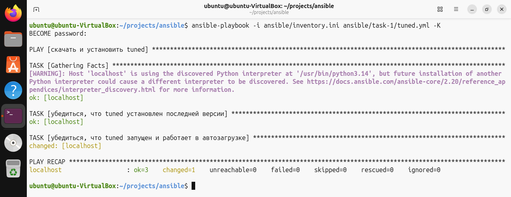
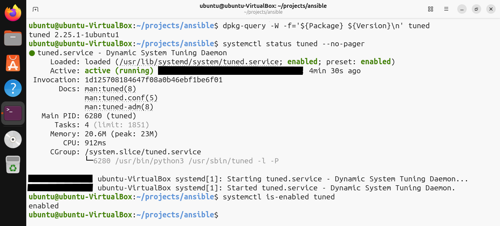
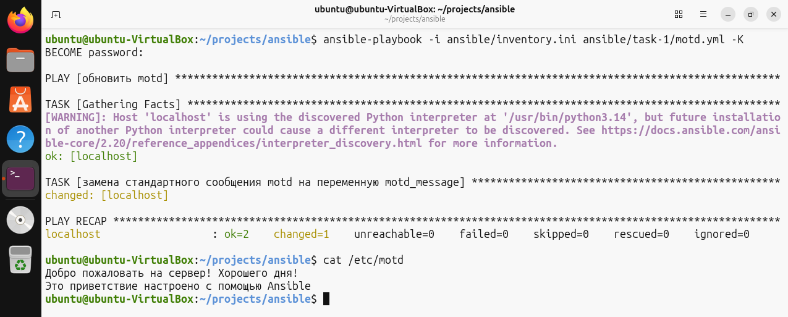
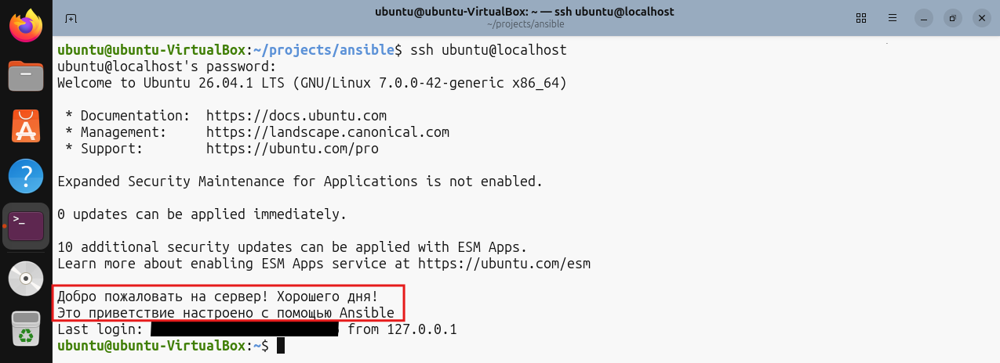
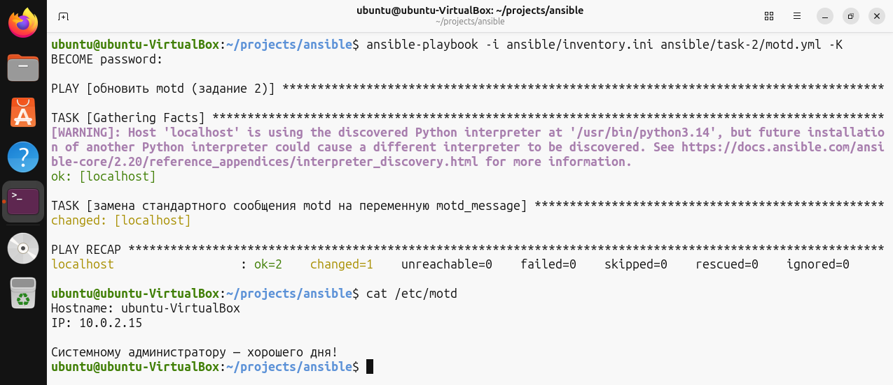
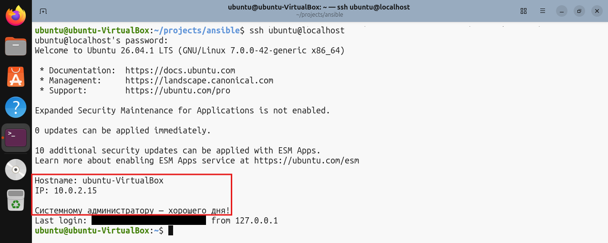
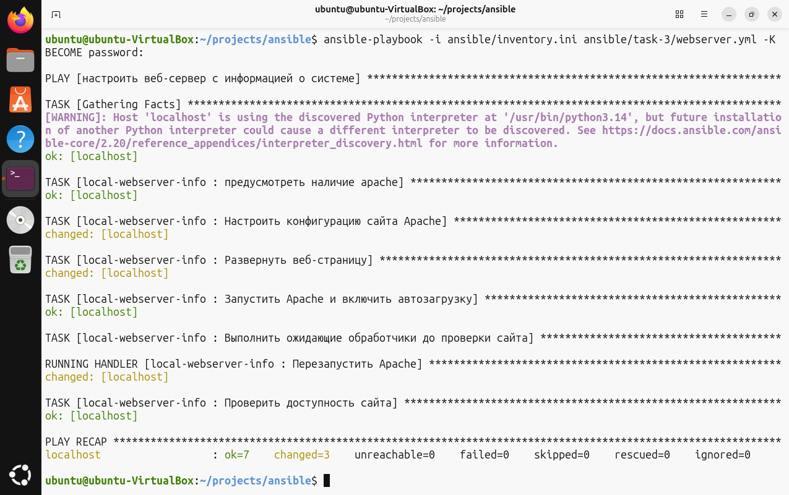
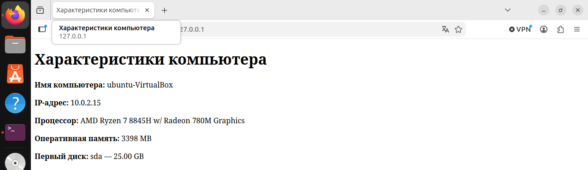

# Домашнее задание к занятию «Ansible. Часть 2» — Шиянов Никита

---

## Задание 1

Напишите три плейбука. При написании рекомендуем использовать текстовый редактор с подсветкой синтаксиса YAML.
Плейбуки должны:

1. Скачать какой-либо архив, создать папку для распаковки и распаковать скаченный архив. Например, можете использовать официальный сайт и зеркало Apache Kafka. При этом можно скачать как исходный код, так и бинарные файлы, запакованные в архив — в нашем задании не принципиально.
2. Установить пакет tuned из стандартного репозитория вашей ОС. Запустить его, как демон — конфигурационный файл systemd появится автоматически при установке. Добавить tuned в автозагрузку.
3. Изменить приветствие системы (motd) при входе на любое другое. Пожалуйста, в этом задании используйте переменную для задания приветствия. Переменную можно задавать любым удобным способом.

### Решение задания 1.1

Плейбук для скачивания и распаковки архива: [download_archive.yml](ansible/task-1/download_archive.yml).
Inventory-файл со списком управляемых хостов: [inventory.ini](ansible/inventory.ini).





### Решение задания 1.2

Плейбук для установки и настройки службы `tuned`: [tuned.yml](ansible/task-1/tuned.yml).





### Решение задания 1.3

Плейбук для изменения приветствия системы с помощью переменной: [motd.yml](ansible/task-1/motd.yml).





---

## Задание 2

Выполните действия, приложите файлы с модифицированным плейбуком и вывод выполнения.

Модифицируйте плейбук из пункта 3, задания 1. В качестве приветствия он должен установить IP-адрес и hostname управляемого хоста, пожелание хорошего дня системному администратору.

### Решение

Плейбук с использованием Ansible facts: [motd.yml](ansible/task-2/motd.yml).





---

## Задание 3

Выполните действия, приложите архив с ролью и вывод выполнения.

Ознакомьтесь со статьёй «Ansible - это вам не bash», сделайте соответствующие выводы и не используйте модули shell или command при выполнении задания.
Создайте плейбук, который будет включать в себя одну, созданную вами роль. Роль должна:

1. Установить веб-сервер Apache на управляемые хосты.
2. Сконфигурировать файл index.html c выводом характеристик каждого компьютера как веб-страницу по умолчанию для Apache. Необходимо включить CPU, RAM, величину первого HDD, IP-адрес. Используйте Ansible facts и jinja2-template. Необходимо реализовать handler: перезапуск Apache только в случае изменения файла конфигурации Apache.
3. Открыть порт 80, если необходимо, запустить сервер и добавить его в автозагрузку.
4. Сделать проверку доступности веб-сайта (ответ 200, модуль uri).

### Решение

Плейбук: [webserver.yml](ansible/task-3/webserver.yml).

Архив с ролью: [local-webserver-info.tar.gz](ansible/task-3/local-webserver-info.tar.gz).

Структура архива:
```
local-webserver-info.tar.gz
└── local-webserver-info/
    ├── handlers/
    │   └── main.yml
    ├── tasks/
    │   └── main.yml
    └── templates/
        ├── index.html.j2
        └── local-webserver-info.conf.j2
```
Файлы роли:
- [tasks/main.yml](ansible/task-3/roles/local-webserver-info/tasks/main.yml) — основные задачи роли.
- [handlers/main.yml](ansible/task-3/roles/local-webserver-info/handlers/main.yml) — обработчики событий.
- [index.html.j2](ansible/task-3/roles/local-webserver-info/templates/index.html.j2) — шаблон веб-страницы.
- [local-webserver-info.conf.j2](ansible/task-3/roles/local-webserver-info/templates/local-webserver-info.conf.j2) — шаблон конфигурации Apache.

Скриншоты выполнения и проверки веб-сервера:



